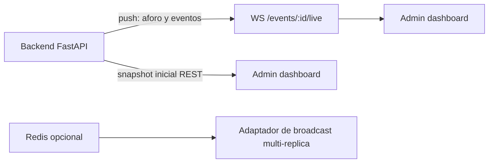

# 1. Arquitectura de Sistemas y Backend

## 1.1 Stack óptimo para alta concurrencia (500+ compradores y escaneos simultáneos)

### Backend
**FastAPI (Python) + Uvicorn (ASGI)** es nuestra elección (y la que ya corre en el repo).

- **Async I/O**: con `async def` y un pool de conexiones (`psycopg_pool`), Uvicorn
  sostiene **miles de conexiones HTTP simultáneas** con pocos hilos. El cuello de
  botella real es la DB, no el framework.
- **Tipado Pydantic** → contratos de API explícitos y validación barata en el borde.
- **Por qué no Node/Go puro**: Python acelera al equipo y el cuello sigue siendo
  PostgreSQL; ante un pico de 500 escaneos/seg, el servidor necesita ser **fácil de
  operar** más que “más rápido en aritmética”.

> ⚠️ **Elección consciente**: no ponemos una cola/Celery para la emisión de boletas.
> La emisión es una transacción corta (un `INSERT` con un lock milisegundo). La cola
> aparece cuando haya **pagos** (confirmación de Wompi) y **envíos de WhatsApp**.

### Base de datos
PostgreSQL 16 (el del repo) con estas protecciones:

- `max_connections` sano (p.ej. 100-200) + **pool del app** acotado.
- **Row-locks** para anti-sobreventa: la DB serializa los pocos milisegundos que dura
  la emisión (ver §2 del modelo y la función `emit_ticket`).
- **Índices**: ya existen `idx_tickets_event_status`, `idx_tickets_token_hash`, etc.

### Capa de presentación
React/Vite SPA (frontend del repo) estática servida por Node (server.mjs) o CDN.
Frontend jamás llama a la DB: solo a la API.

## 1.2 REST vs GraphQL → decisión

**REST.** Justificación:

| Criterio | REST | GraphQL |
|---|---|---|
| Simplicidad operativa | ✅ cacheo HTTP, logs, debug | ❌ más piezas (schema, resolvers, data-loaders) |
| Complejidad del grafo del dominio | Baja (boleta→evento→tenant) | Solo gana con grafos profundos |
| Equipo pequeño | ✅ predecible | ❌ sobre-ingeniería |
| Bouncer móvil offline | ✅ snapshot probable genera un endpoint | ❌ menos control de qué se descarga |

**Convención de rutas** usada en el repo:

```
POST /auth/login                    → token JWT
GET  /venues/{venue_id}/events      → eventos del tenant
POST /venues/{venue_id}/events/{id}/tickets   → emitir (anti-sobreventa en DB)
POST /venues/{venue_id}/events/{id}/redeem    → validar QR (compare-and-swap)
GET  /venues/{venue_id}/events/{id}/report    → aforo/ventas en vivo
```

## 1.3 WebSockets para aforo en tiempo real

**Para qué sirven de verdad (y para qué NO):**

| Dato | Canal | Por qué |
|---|---|---|
| % de aforo, boletas redimidas en el minuto, aviso 80%/90% | **WebSocket** (push) | El admin mueve el dashboard en vivo; no sirve polling de 1s a 100 usuarios |
| Emitir boleta / validar QR | **REST** | Es una transacción que requiere respuesta/estado; el WS no agrega nada |

**Patrón para el WS**: un endpoint `WS /events/{id}/live` autenticado por JWT que
transmite los *cambios* (no el estado completo). Cada cambio es un evento de
dominio: `ticket.redeemed {ticket_id, ts}`. El dashboard reconstruye las tarjetas.

**Circuito anti-recuento**: el WS no debe gastar N queries en cada broadcast.
Una sola query `SELECT count(*) ...` cada 2s con un `vectorclock`/`seq` local, o
`LISTEN/NOTIFY` de Postgres cuando el uso crezca.



## 1.4 Diseño de la transacción crítica (emitir) — código

La anti-sobreventa se concentra en `emit_ticket()` (ya en `db/schema.sql`).
Lo que el equipo debe **respetar**: nunca validar cupo en app; siempre pasar por la función.

```sql
-- (resumen del dolor clave, la función completa vive en db/schema.sql)
SELECT capacity, status FROM events WHERE id=$1 FOR UPDATE;      -- lock del aforo
SELECT count(*) FROM tickets WHERE event_id=$1 AND status NOT IN ('voided','refunded');
IF count >= capacity THEN RAISE 'event_at_capacity'; END IF;
INSERT INTO tickets (...) VALUES (...);
```

**Probado**: el smoke test + script de concurrencia del repo lanzan N procesos
contra un cupo y garantiza que solo `capacity` entran (ver `docs/arquitectura/07`).

## 1.5 Decisiones para cuando haya pagos (Fase 2)

- El dinero va **directo a la cuenta de la discoteca** (Wompi/MP vía subcuentas o
  split); la plataforma factura la comisión aparte. Evita el infierno del
  reembolso de la “cuenta nodriza”.
- El webhook de confirmación de pago es la única fuente que cambia `issued → "paid"`.
- Concurrencia de pago + contra-cargo: el webhook debe ser idempotente por
  `payment_intent_id` (columna UNIQUE).