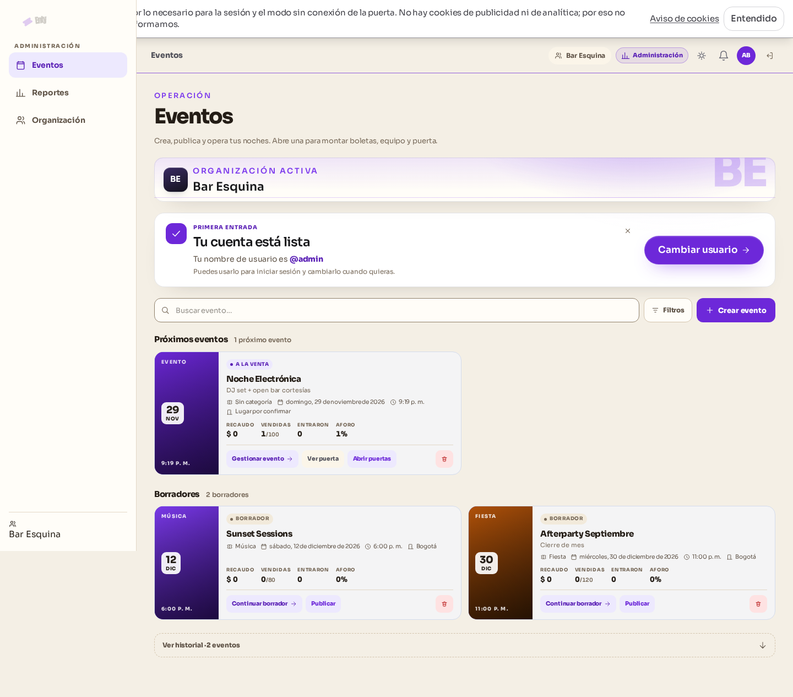
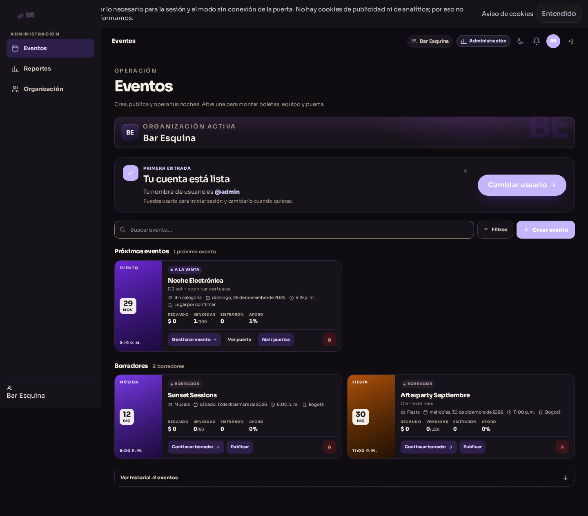
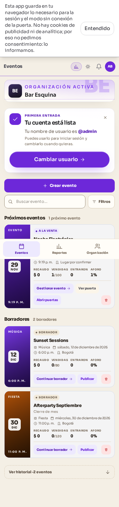
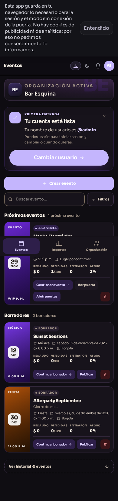
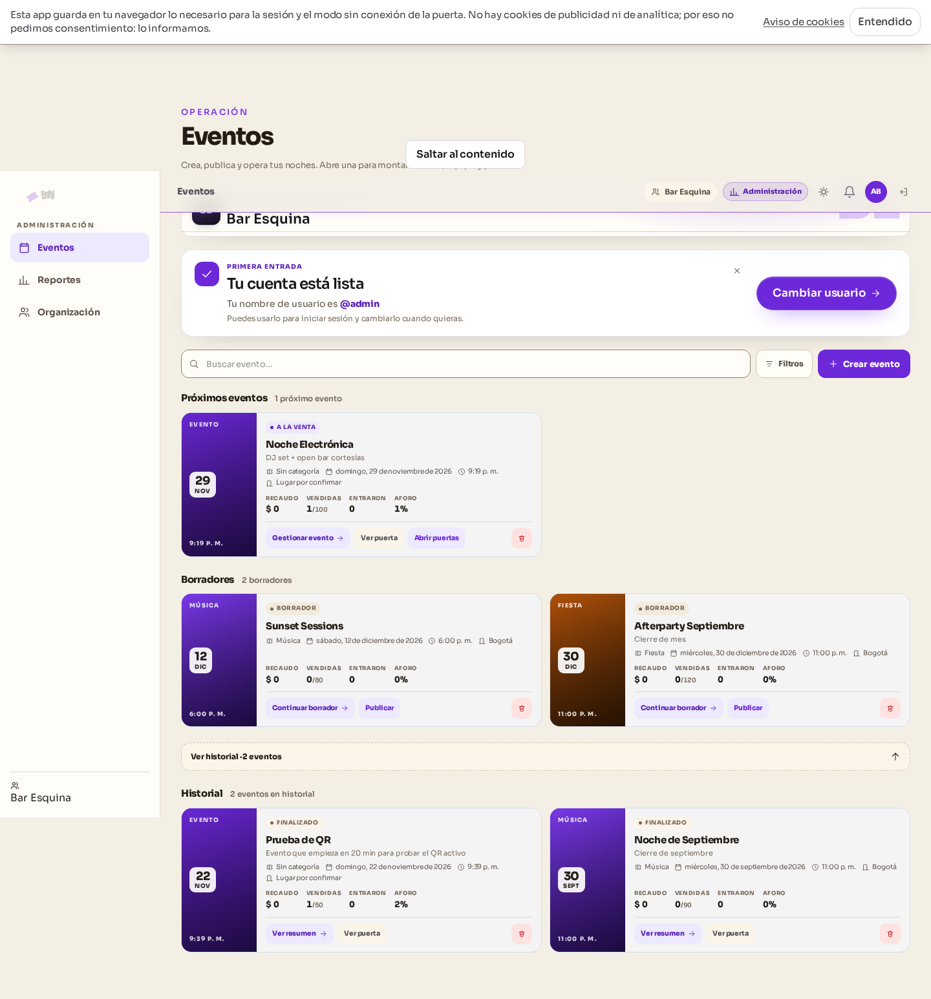
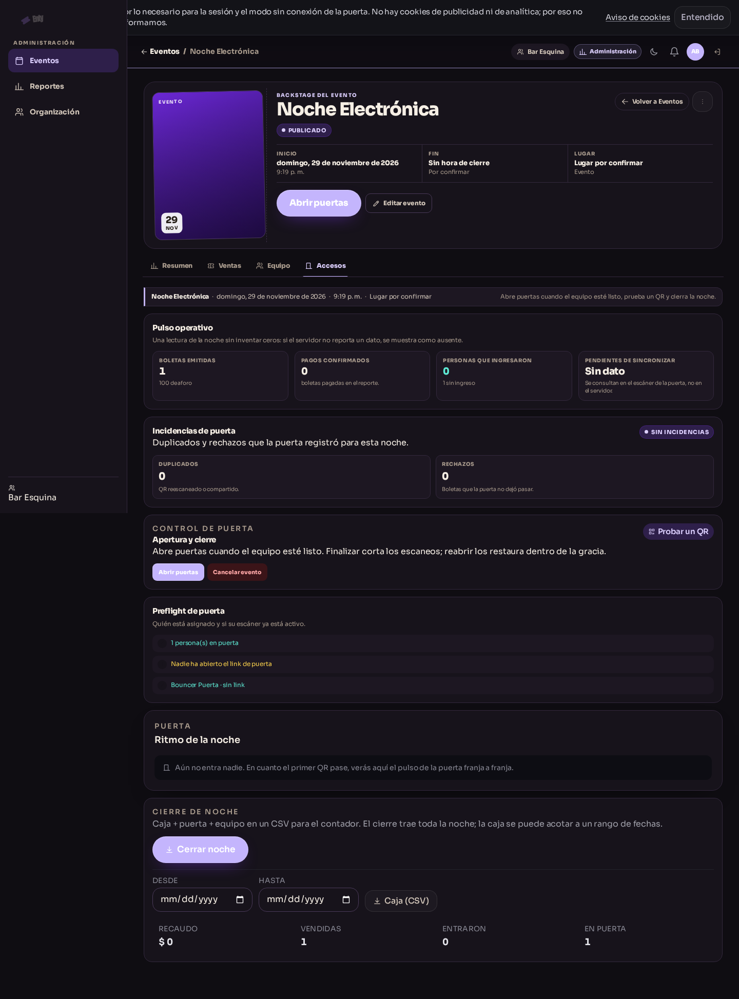
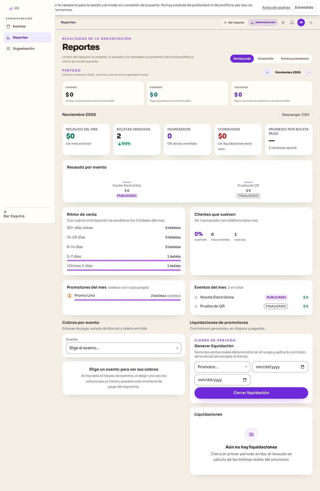
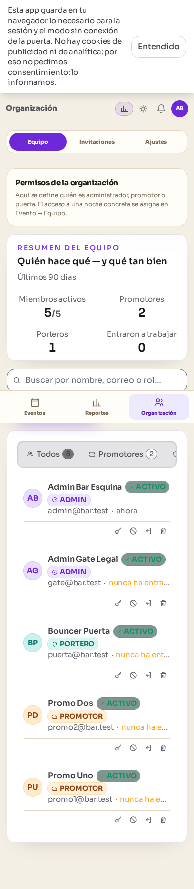

# Rediseño de Eventos y backstage

Este documento resume la entrega del rediseño del área de Administración: el
listado de eventos, el backstage de cada noche y el contexto de evento en las
notificaciones.

## Qué cambió

### Listado de eventos

- Las tarjetas muestran categoría, fecha completa, hora, lugar, recaudo,
  vendidas, ingresaron y aforo.
- La hora y la fecha se calculan en la zona del evento. Un evento guardado a
  las 21:19 en Bogotá ya no aparece como el día siguiente a las 2:19 a. m.
- Los estados se agrupan en **En puerta**, **Próximos eventos**, **Borradores**
  e **Historial**. El historial se abre bajo demanda.
- El cartel del evento aparece en la tarjeta cuando existe lineup, sin abrir el
  backstage.
- En móvil la creación es una sola acción de ancho completo, antes del buscador
  y de Filtros. El título de Eventos vive en la barra superior para no repetirlo
  en el contenido.
- Un enlace a un evento inexistente conserva el `?event=` en la URL y explica
  que el evento se eliminó o que ya no hay acceso. No borra el contexto del
  aviso.
- El botón deshabilitado **Entrada gratuita** conserva el contraste AA: antes
  bajaba a 3.12:1 por una opacidad de 0.62 y ahora mantiene el texto legible.

### Backstage del evento

El backstage separa el trabajo en cuatro secciones:

| Sección | Contenido |
| --- | --- |
| Resumen | Identidad, fechas, pulso operativo, incidencias, control de puerta y cierre de noche |
| Ventas | Boletas, pagos y conciliación |
| Equipo | Personal asignado, permisos y accesos |
| Accesos | QR, puerta y enlaces de escaneo |

La cabecera mantiene siempre visible el nombre del evento, su estado y las
acciones principales. En móvil las pestañas siguen accesibles sin scroll
horizontal.

### Notificaciones con contexto de evento

Las alertas de capacidad, reemisión de boletas y recordatorio de turno incluyen
el nombre del evento. El enlace lleva a la sección correcta:

- Capacidad y anomalías de puerta → `Accesos` del evento.
- Reemisión y pagos → `Ventas` del evento.
- Recordatorio de turno → `Resumen` para administración, `/bouncer?evento=N`
  para puerta y `/promotor` para promotores.

El frontend traduce enlaces antiguos (`/admin`, `?tab=equipo`, etc.) a la
sección equivalente actual, sin romper avisos ya guardados.

## Capturas

### Listado en escritorio

### Listado en móvil

### Historial

### Backstage del evento

### Reportes y Organización

## Verificación

| Comprobación | Resultado |
| --- | --- |
| `backend/.venv/bin/python -m pytest -q` | 707 pasaron, 1 omitido |
| `npm run test:unit` | Pasó |
| `npm run lint:js` | Pasó, solo advertencias dentro del máximo |
| `npm run build` | Pasó |
| `npx playwright test` | Suite completa en verde |
| `test_schema_drift.py` | Pasó: `db/schema.sql` es la fuente única |

Las migraciones `061_notification_event_context.sql` y
`062_login_lockout_ignores_sentinels.sql` están registradas en
`scripts/deploy.sh` y en `backend/tests/conftest.py`. Sus funciones también
quedaron consolidadas en `db/schema.sql`. La 062 evita que las altas y los
resets agoten el cubo de IP del login.
